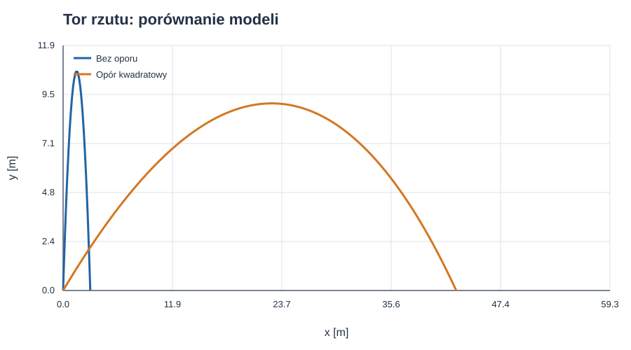
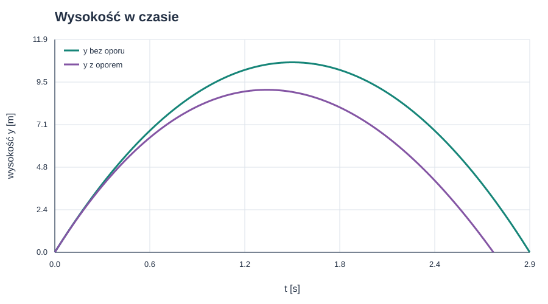
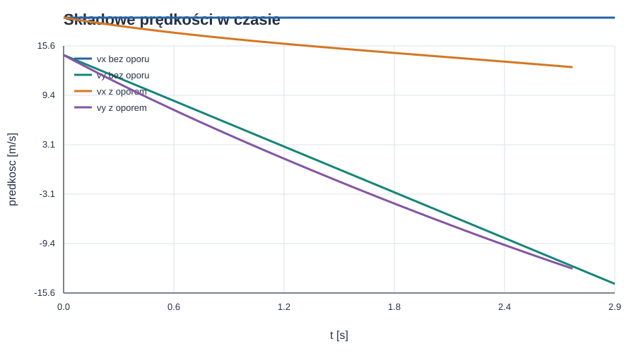
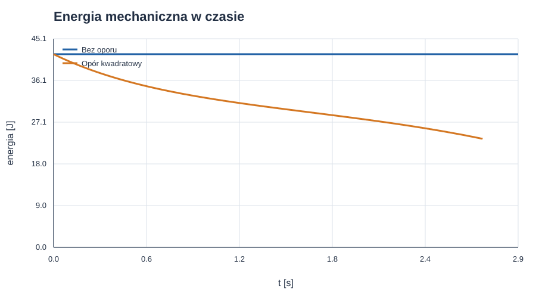

# Rzut ukośny — od paraboli do ruchu z oporem powietrza

*Raport obliczeniowy o ruchu ciała wyrzuconego pod kątem do poziomu.*

**Temat:** tor, czas lotu i zasięg rzutu ukośnego.

**Metoda:** rozwiązanie analityczne dla ruchu bez oporu oraz całkowanie numeryczne modelu z oporem kwadratowym.

**Charakter danych:** przykład modelowy; wartości nie pochodzą z pomiaru laboratoryjnego. Cyfry $24$ i $37$ są fikcyjnymi wartościami demonstracyjnymi, użytymi na prośbę autora raportu — nie potwierdzają zgodności z rzeczywistym numerem indeksu.

Rzut ukośny można rozłożyć na dwa prostsze ruchy: poziomy, w którym ciało bez oporu porusza się ze stałą prędkością, oraz pionowy, w którym działa przyspieszenie grawitacyjne. Po uwzględnieniu oporu powietrza składowe przestają być niezależne — siła oporu zależy od całej prędkości i zmienia się wraz z ruchem.

## Spis treści

1. [Cel i założenia modelu](#1-cel-i-założenia-modelu)
2. [Rzut bez oporu powietrza](#2-rzut-bez-oporu-powietrza)
3. [Rzut z oporem powietrza](#3-rzut-z-oporem-powietrza)
4. [Przykład liczbowy i porównanie](#4-przykład-liczbowy-i-porównanie)
5. [Wykresy ruchu](#5-wykresy-ruchu)
6. [Kod i odtwarzanie wykresów](#6-kod-i-odtwarzanie-wykresów)
7. [Jak wykonać doświadczenie](#7-jak-wykonać-doświadczenie)
8. [Wnioski](#8-wnioski)
9. [Dalsza lektura](#9-dalsza-lektura)

---

## 1. Cel i założenia modelu

Celem raportu jest opisanie położenia i prędkości ciała wyrzuconego z prędkością początkową $v_0$ pod kątem $\alpha$ do poziomu. Porównujemy model idealny z modelem, w którym powietrze stawia opór.

### 1.1. Założenia

- Układ współrzędnych jest nieruchomy względem podłoża; oś $x$ jest pozioma, a oś $y$ skierowana pionowo w górę.
- Przyspieszenie grawitacyjne ma stałą wartość $g=9{,}81\,\mathrm{m/s^2}$ i jest skierowane w dół.
- W modelu idealnym pomijamy opór powietrza oraz rozmiar i obrót ciała.
- W modelu z oporem powietrza powietrze jest nieruchome, a współczynnik oporu i gęstość powietrza są stałe.
- Lądowanie następuje na wysokości startu, chyba że podano inaczej.

Wektor położenia zapisujemy jako $\mathbf{r}=(x,y)$, a wektor prędkości jako $\mathbf{v}=(v_x,v_y)$. Kąt $\alpha$ mierzymy od dodatniego kierunku osi poziomej.

### 1.2. Symbole i jednostki

| Symbol | Znaczenie | Jednostka SI |
| :--- | :--- | :---: |
| $x$, $y$ | współrzędne położenia | $\mathrm{m}$ |
| $v_x$, $v_y$, $v$ | składowe prędkości i szybkość | $\mathrm{m/s}$ |
| $a_x$, $a_y$ | składowe przyspieszenia | $\mathrm{m/s^2}$ |
| $v_0$, $\alpha$ | prędkość początkowa i kąt wyrzutu | $\mathrm{m/s}$, $\mathrm{rad}$ |
| $g$ | przyspieszenie grawitacyjne | $\mathrm{m/s^2}$ |
| $t$, $T$ | czas i czas lotu | $\mathrm{s}$ |
| $R$, $H$ | zasięg poziomy i maksymalna wysokość | $\mathrm{m}$ |
| $m$ | masa ciała | $\mathrm{kg}$ |
| $\rho$ | gęstość powietrza | $\mathrm{kg/m^3}$ |
| $C_D$ | bezwymiarowy współczynnik oporu | bez jednostki |
| $A$ | pole powierzchni czołowej | $\mathrm{m^2}$ |

---

## 2. Rzut bez oporu powietrza

### 2.1. Składowe prędkości początkowej

Prędkość początkową rozkładamy na składowe:

$$
v_{0x}=v_0\cos\alpha,
\qquad
v_{0y}=v_0\sin\alpha.
$$

Bez oporu poziome przyspieszenie jest równe zeru, a pionowe wynosi $-g$:

$$
a_x=0,
\qquad
a_y=-g.
$$

Dla chwili początkowej $t=0$ i położenia $(x_0,y_0)$ równania ruchu są następujące:

$$
x(t)=x_0+v_0\cos\alpha\,t,
$$

$$
y(t)=y_0+v_0\sin\alpha\,t-\frac{1}{2}gt^2.
$$

Prędkość zmienia się według zależności:

$$
v_x(t)=v_0\cos\alpha,
\qquad
v_y(t)=v_0\sin\alpha-gt.
$$

W najwyższym punkcie toru $v_y=0$. Nie oznacza to, że całkowita prędkość jest tam równa zeru — składowa pozioma nadal wynosi $v_0\cos\alpha$.

### 2.2. Kształt toru

Eliminujemy czas z równań położenia, korzystając z $t=(x-x_0)/(v_0\cos\alpha)$. Dla $\cos\alpha\ne0$ otrzymujemy:

$$
y(x)=y_0+(x-x_0)\tan\alpha
-\frac{g(x-x_0)^2}{2v_0^2\cos^2\alpha}.
$$

Jest to parabola. Jej kształt wynika z połączenia stałej prędkości poziomej i stałego przyspieszenia pionowego. Dla rzutu pionowego, gdy $\cos\alpha=0$, ciało nie przemieszcza się poziomo i powyższa postać $y(x)$ nie ma zastosowania.

### 2.3. Czas lotu, wysokość maksymalna i zasięg

Dla startu i lądowania na tej samej wysokości ($y_0=0$) z równania $y(T)=0$ wynika niezerowy czas lotu:

$$
T=\frac{2v_0\sin\alpha}{g}.
$$

W najwyższym punkcie $v_y=0$, więc czas wznoszenia i maksymalna wysokość względem miejsca wyrzutu wynoszą:

$$
t_H=\frac{v_0\sin\alpha}{g},
\qquad
H=\frac{v_0^2\sin^2\alpha}{2g}.
$$

Zasięg poziomy to $R=x(T)-x_0$:

$$
R=\frac{v_0^2\sin(2\alpha)}{g}.
$$

Przy ustalonym $v_0$ i równych wysokościach startu oraz lądowania model idealny przewiduje największy zasięg dla $\alpha=\pi/4\,\mathrm{rad}$ (czyli $45^\circ$). Kąty $\alpha$ i $\pi/2-\alpha$ dają taki sam zasięg, lecz inną wysokość maksymalną i czas lotu. Wniosek o kącie $\pi/4\,\mathrm{rad}$ zależy od tych założeń — nie jest uniwersalny, gdy start i lądowanie są na różnych wysokościach albo działa opór.

**Kontrola jednostek:** $v_0^2/g$ ma jednostkę $\mathrm{m}$, a $v_0/g$ — $\mathrm{s}$.

---

## 3. Rzut z oporem powietrza

### 3.1. Kierunek i model siły oporu

Siła oporu działa przeciwnie do prędkości względem powietrza. W typowym zakresie prędkości dla ciał poruszających się w powietrzu często stosuje się model kwadratowy:

$$
\mathbf{F}_{\mathrm{op}}
=-\frac{1}{2}\rho C_D A\,|\mathbf{v}|\,\mathbf{v}.
$$

Znak minus wskazuje przeciwny zwrot. Ponieważ $|\mathbf{v}|=\sqrt{v_x^2+v_y^2}$, składowe siły zależą jednocześnie od $v_x$ i $v_y$. Równania Newtona przyjmują postać:

$$
\dot{x}=v_x,
\qquad
\dot{y}=v_y,
$$

$$
\dot{v}_x=-c|\mathbf{v}|v_x,
\qquad
\dot{v}_y=-g-c|\mathbf{v}|v_y,
\qquad
c=\frac{\rho C_D A}{2m}.
$$

Współczynnik $c$ ma jednostkę $\mathrm{m^{-1}}$. Dla prędkości względem poruszającego się powietrza należy w równaniu oporu zastąpić $\mathbf{v}$ prędkością względną $\mathbf{v}-\mathbf{u}_{\mathrm{pow}}$.

Przy małych prędkościach lub w innym zakresie przepływu spotyka się również model liniowy $\mathbf{F}_{\mathrm{op}}=-b\mathbf{v}$, gdzie $b$ jest współczynnikiem proporcjonalności. Wybór między modelem liniowym a kwadratowym zależy od warunków przepływu i geometrii ciała; w przykładzie liczbowym używamy modelu kwadratowego.

### 3.2. Co zmienia opór?

- Składowa pozioma prędkości maleje, więc zasięg jest mniejszy niż w modelu idealnym przy tych samych warunkach początkowych.
- Tor nie jest parabolą: przyspieszenie zależy od aktualnej prędkości.
- Wznoszenie i opadanie nie są symetryczne. Po przejściu przez wierzchołek ruchu ciało na ogół nie wraca po tej samej krzywej.
- Kąt dający największy zasięg zależy od masy, kształtu, rozmiaru, gęstości powietrza, prędkości początkowej i wysokości lądowania. Zwykle nie wynosi dokładnie $\pi/4\,\mathrm{rad}$.
- Energia mechaniczna maleje, ponieważ opór rozprasza ją w postaci energii wewnętrznej powietrza i ciała.

Dla modelu kwadratowego nie ma na ogół prostych wzorów analitycznych na cały tor i zasięg. Równania ruchu rozwiązuje się numerycznie, na przykład metodą Rungego–Kutty.

### 3.3. Energia i prędkość graniczna

Moc siły oporu jest ujemna:

$$
\frac{d}{dt}\left(\frac{1}{2}mv^2+mgy\right)
=\mathbf{F}_{\mathrm{op}}\cdot\mathbf{v}
=-\frac{1}{2}\rho C_D A\,v^3\le0.
$$

Dla pionowego spadania w modelu kwadratowym prędkość graniczną można oszacować, zrównując ciężar i wartość siły oporu:

$$
v_{\mathrm{gr}}=
\sqrt{\frac{2mg}{\rho C_D A}}.
$$

Jest to wynik dla spadania pionowego w dół, przy stałych parametrach oporu. Nie oznacza, że w rzucie ukośnym wektor prędkości od razu przyjmuje tę wartość.

---

## 4. Przykład liczbowy i porównanie

Przyjmijmy fikcyjne cyfry indeksu: pierwsze dwie to $24$, a ostatnie dwie to $37$. Zgodnie z poleceniem przyjmujemy więc $v_0=24\,\mathrm{m/s}$ oraz $\alpha=37^\circ\approx0{,}6458\,\mathrm{rad}$. Stopnie podajemy dla czytelności, a w obliczeniach kąt zapisujemy w radianach — jednostce SI kąta płaskiego. Wartości te są wyłącznie przykładowe i należy je zastąpić cyframi z własnego indeksu, jeśli raport ma być zgodny z indywidualnym numerem.

Dla porównania z oporem wybieramy modelową piłkę o masie $m=0{,}145\,\mathrm{kg}$, polu czołowym $A=0{,}0042\,\mathrm{m^2}$ i współczynniku $C_D=0{,}47$. Przyjmujemy gęstość powietrza $\rho=1{,}225\,\mathrm{kg/m^3}$ oraz start i lądowanie na tym samym poziomie.

### 4.1. Wyniki modelu idealnego

$$
T=\frac{2(24)\sin(37\pi/180\,\mathrm{rad})}{9{,}81}
\approx2{,}945\,\mathrm{s},
$$

$$
H=\frac{(24)^2\sin^2(37\pi/180\,\mathrm{rad})}{2(9{,}81)}
\approx10{,}633\,\mathrm{m},
$$

$$
R=\frac{(24)^2\sin(2\cdot37\pi/180\,\mathrm{rad})}{9{,}81}
\approx56{,}441\,\mathrm{m}.
$$

### 4.2. Wyniki z oporem kwadratowym

Dla podanych parametrów:

$$
c=\frac{(1{,}225)(0{,}47)(0{,}0042)}{2(0{,}145)}
\approx0{,}00834\,\mathrm{m^{-1}}.
$$

Całkowanie równań ruchu daje w przybliżeniu:

| Wielkość | Bez oporu | Z oporem kwadratowym |
| :--- | ---: | ---: |
| Czas lotu | $2{,}945\,\mathrm{s}$ | $2{,}719\,\mathrm{s}$ |
| Maksymalna wysokość nad miejscem startu | $10{,}633\,\mathrm{m}$ | $9{,}095\,\mathrm{m}$ |
| Zasięg | $56{,}441\,\mathrm{m}$ | $42{,}601\,\mathrm{m}$ |
| Czas do wierzchołka | $1{,}472\,\mathrm{s}$ | $1{,}316\,\mathrm{s}$ |
| Położenie wierzchołka w poziomie | $28{,}221\,\mathrm{m}$ | $22{,}611\,\mathrm{m}$ |

Wartości dla oporu są wynikiem symulacji numerycznej i zależą od przyjętych parametrów oraz modelu. W tym przykładzie opór skraca zasięg o około $24{,}5\%$ względem wartości idealnej. Wyniki nie opisują każdej piłki ani warunków pogodowych — zmiana masy, powierzchni czołowej, współczynnika oporu lub wiatru zmieni rezultat.

---

## 5. Wykresy ruchu

Poniższe wykresy zostały wygenerowane lokalnie przez skrypt Python z dołączonego pliku źródłowego. Niebieskie serie pokazują model bez oporu, a pomarańczowe lub fioletowe — rozwiązanie numeryczne z oporem kwadratowym. Współrzędne podano w metrach, czas w sekundach, prędkość w metrach na sekundę, a energię w dżulach.



*Rysunek 1. Opór zmniejsza zasięg i wysokość, a tor przestaje być parabolą.*



*Rysunek 2. W modelu idealnym wysokość zmienia się parabolicznie; opór obniża wierzchołek i skraca czas lotu.*



*Rysunek 3. Bez oporu $v_x$ jest stałe. Z oporem obie składowe prędkości zmieniają się w czasie.*



*Rysunek 4. Energia mechaniczna jest zachowana w modelu idealnym i maleje wskutek pracy siły oporu.*

---

## 6. Kod i odtwarzanie wykresów

Pełny, uruchamialny skrypt generujący wszystkie cztery obrazy znajduje się w pliku [generuj_wykresy.py](generuj_wykresy.py). Korzysta wyłącznie ze standardowej biblioteki Pythona — nie wymaga Colaba ani instalowania dodatkowych pakietów. Zawiera też kod zapisujący wykresy do plików SVG. Poniższy, samodzielny fragment pokazuje metodę Rungego–Kutty czwartego rzędu używaną w skrypcie:

```python
from math import cos, hypot, radians, sin

G, V0, ALPHA_DEG = 9.81, 24.0, 37.0
ANGLE = radians(ALPHA_DEG)
MASS, RHO, CD, AREA = 0.145, 1.225, 0.47, 0.0042
DRAG_C = RHO * CD * AREA / (2 * MASS)
DT = 0.002  # s
INITIAL = [0.0, 0.0, V0 * cos(ANGLE), V0 * sin(ANGLE)]

def add_scaled(state, slope, scale):
    return [value + scale * change for value, change in zip(state, slope)]

def derivative(state):
    _, _, vx, vy = state
    speed = hypot(vx, vy)
    return [vx, vy, -DRAG_C * speed * vx, -G - DRAG_C * speed * vy]

def simulate():
    time, state = 0.0, INITIAL[:]
    samples = [(time, state[:])]
    while time < 20.0:
        k1 = derivative(state)
        k2 = derivative(add_scaled(state, k1, DT / 2))
        k3 = derivative(add_scaled(state, k2, DT / 2))
        k4 = derivative(add_scaled(state, k3, DT))
        following = [
            value + DT * (a + 2 * b + 2 * c + d) / 6
            for value, a, b, c, d in zip(state, k1, k2, k3, k4)
        ]
        if following[1] < 0:  # interpolacja chwili lądowania
            fraction = state[1] / (state[1] - following[1])
            landing = [
                value + fraction * (next_value - value)
                for value, next_value in zip(state, following)
            ]
            samples.append((time + fraction * DT, landing))
            return samples
        time += DT
        state = following
        samples.append((time, state[:]))
    raise RuntimeError("Nie wykryto lądowania w zadanym czasie.")

samples = simulate()
print(f"Czas lotu: {samples[-1][0]:.3f} s")
```

Wektor stanu ma postać $(x,y,v_x,v_y)$. Skrypt wylicza cztery nachylenia na każdym kroku, a ich ważona średnia daje przybliżenie rozwiązania w następnym kroku. Krok czasu wynosi $0{,}002\,\mathrm{s}$. Punkt lądowania jest interpolowany między ostatnim punktem nad podłożem a pierwszym punktem poniżej $y=0$.

Aby ponownie obliczyć wyniki i wygenerować obrazy, uruchom z katalogu repozytorium:

```bash
python pages/solutions/04_sol_vscode/generuj_wykresy.py
```

Pliki SVG zostaną zapisane w `pages/solutions/04_sol_vscode/files/rzut_ukosny/` i są osadzone powyżej jako rysunki 1–4.

---

## 7. Jak wykonać doświadczenie

### 6.1. Procedura pomiarowa

1. Wybierz niewielki, niezbyt lekki obiekt i ustal miejsce wyrzutu oraz poziom lądowania.
2. Zmierz lub oszacuj masę obiektu. Zapisz jego kształt i wymiary, ponieważ wpływają na opór.
3. Zmierz prędkość początkową i kąt wyrzutu, najlepiej na podstawie nagrania z boku z widoczną skalą.
4. Nagraj cały lot w nieruchomym układzie kamery, prostopadle do płaszczyzny ruchu.
5. Wyznacz położenia obiektu w kolejnych klatkach i porównaj je z modelem idealnym oraz numerycznym modelem oporu.
6. Powtórz pomiar kilka razy i podaj rozrzut wyników zamiast opierać wniosek na jednym rzucie.

Nie należy wykonywać doświadczenia w pobliżu ludzi, okien ani ruchu drogowego. Bezpieczeństwo i stabilny, niezakłócony kadr są ważniejsze niż zwiększanie prędkości wyrzutu.

### 6.2. Ograniczenia pomiaru i modelu

- Niepewność kąta i prędkości początkowej wpływa na przewidywany zasięg.
- Perspektywa kamery i jej ruch mogą powodować błędne odczyty położenia.
- Opór zależy od kształtu, orientacji, obrotu i prędkości; stałe $C_D$ jest przybliżeniem.
- Podmuchy wiatru zmieniają prędkość ciała względem powietrza.
- Przy obiektach wirujących mogą pojawić się dodatkowe siły aerodynamiczne, których ten model nie uwzględnia.
- Jeśli różnica między pomiarem a obliczeniem jest większa niż niepewność, należy najpierw sprawdzić warunki początkowe i założenia, a nie dopasowywać wynik przez przypadkową zmianę parametrów.

---

## 8. Wnioski

1. Bez oporu powietrza składowe ruchu poziomego i pionowego można analizować niezależnie, a tor jest parabolą.
2. Przy równych wysokościach startu i lądowania czas lotu, wysokość maksymalną i zasięg wyznaczają proste wzory. W modelu idealnym największy zasięg występuje dla kąta $\pi/4\,\mathrm{rad}$.
3. Opór powietrza zmniejsza prędkość, zasięg i zwykle wysokość maksymalną. Ponieważ siła zależy od wektora prędkości, tor przestaje być parabolą.
4. Dla oporu kwadratowego ruch oblicza się numerycznie. Wynik należy interpretować razem z przyjętymi parametrami i ograniczeniami modelu.
5. Dla przykładowych parametrów zasięg zmniejszył się z około $56{,}441\,\mathrm{m}$ do $42{,}601\,\mathrm{m}$. Są to wyniki konkretnego modelu, a nie wartości uniwersalne.

---

## 9. Dalsza lektura

- [OpenStax: Projectile Motion](https://openstax.org/books/university-physics-volume-1/pages/4-3-projectile-motion) — rozkład ruchu na składowe i równania rzutu bez oporu.
- [NASA Glenn: The Drag Equation](https://www1.grc.nasa.gov/beginners-guide-to-aeronautics/drag-equation/) — równanie oporu aerodynamicznego i znaczenie jego parametrów.
- [Dokumentacja Pythona: moduł `math`](https://docs.python.org/3/library/math.html) — funkcje trygonometryczne wykorzystywane do zamiany kąta i obliczeń analitycznych.